# HS Shop logical ERD

The diagram below reflects the clarified MVP boundary: products may have multiple supplier options (factory/showroom), with one selected for each ordered product line. Product availability is manually controlled; procurement and inventory processes are outside scope.

```mermaid
erDiagram
 USERS ||--o| CUSTOMERS : profile
 USERS ||--o{ USER_ROLE : assigned
 ROLES ||--o{ USER_ROLE : includes
 ROLES ||--o{ ROLE_PERMISSION : grants
 PERMISSIONS ||--o{ ROLE_PERMISSION : granted
 CUSTOMERS ||--o{ CUSTOMER_ADDRESSES : saves
 PRODUCTS ||--o{ PRODUCT_SUPPLIERS : offered_by
 SUPPLIERS ||--o{ PRODUCT_SUPPLIERS : supplies
 PRODUCT_SUPPLIERS ||--o{ PRODUCT_SUPPLIER_HISTORY : history
 PRODUCT_SUPPLIERS ||--o{ ORDER_ITEM_SUPPLIER_SELECTIONS : selected_for
 SUPPLIERS ||--o{ ORDER_ITEM_SUPPLIER_SELECTIONS : chosen_supplier
 USERS o|--o{ ORDER_ITEM_SUPPLIER_SELECTIONS : selects
 CATEGORIES ||--o{ CATEGORIES : parent
 CATEGORIES ||--o{ CATEGORY_TRANSLATIONS : translated
 BRANDS ||--o{ BRAND_TRANSLATIONS : translated
 BRANDS o|--o{ PRODUCTS : brands
 PRODUCTS ||--o{ PRODUCT_TRANSLATIONS : translated
 PRODUCTS ||--o{ PRODUCT_CATEGORIES : categorized
 CATEGORIES ||--o{ PRODUCT_CATEGORIES : classifies
 PRODUCTS ||--o{ PRODUCT_COLLECTION_ITEMS : curated
 PRODUCT_COLLECTIONS ||--o{ PRODUCT_COLLECTION_ITEMS : contains
 PRODUCTS ||--o{ PRODUCT_VARIANTS : has
 PRODUCT_VARIANTS ||--o{ PRODUCT_PRICE_HISTORY : priced_by
 USERS ||--o{ PRODUCT_PRICE_HISTORY : records
 PRODUCTS ||--o{ PRODUCT_AVAILABILITY_HISTORY : checked
 USERS ||--o{ PRODUCT_AVAILABILITY_HISTORY : checks
 PRODUCT_VARIANTS ||--o{ VARIANT_ATTRIBUTE_VALUES : configured
 ATTRIBUTES ||--o{ ATTRIBUTE_VALUES : defines
 ATTRIBUTES ||--o{ ATTRIBUTE_TRANSLATIONS : translated
 ATTRIBUTE_VALUES ||--o{ ATTRIBUTE_VALUE_TRANSLATIONS : translated
 ATTRIBUTE_VALUES ||--o{ VARIANT_ATTRIBUTE_VALUES : selected_value
 PRODUCT_COLLECTIONS ||--o{ PRODUCT_COLLECTION_TRANSLATIONS : translated
 PRODUCTS ||--o{ PRODUCT_IMAGES : illustrated
 PRODUCT_VARIANTS o|--o{ PRODUCT_IMAGES : variant_image
 CUSTOMERS o|--o{ CARTS : owns
 CARTS ||--o{ CART_ITEMS : contains
 PRODUCT_VARIANTS ||--o{ CART_ITEMS : selected
 CUSTOMERS ||--o{ CUSTOMER_FAVORITES : saves
 PRODUCTS ||--o{ CUSTOMER_FAVORITES : favorited
 CUSTOMERS ||--o{ ORDERS : places
 USERS ||--o{ ORDERS : creates
 ORDERS ||--o{ ORDER_ITEMS : contains
 ORDERS ||--o{ ORDER_ACTIVITY_EVENTS : audited_by
 USERS o|--o{ ORDER_ACTIVITY_EVENTS : acts
 ORDERS ||--o{ ORDER_REVISIONS : versioned
 ORDER_REVISIONS ||--o{ CUSTOMER_APPROVALS : approved
 ORDER_REVISIONS ||--o{ ORDER_REVISION_ITEMS : snapshots
 ORDER_REVISIONS ||--o{ ORDER_REVISION_ADDRESSES : snapshots
 ORDER_ITEMS ||--o{ ORDER_REVISION_ITEMS : identity
 ORDER_ITEMS ||--o{ ORDER_ITEM_SUPPLIER_SELECTIONS : supplier_choice
 ORDERS ||--o{ PAYMENTS : payable
 PAYMENTS ||--o{ PAYMENT_TRANSACTIONS : attempts
 PAYMENT_TRANSACTIONS ||--o{ PAYMENT_PROOFS : documented
 ORDERS ||--o{ REFUNDS : refunded
 PAYMENTS o|--o{ REFUNDS : source_payment
 ORDERS ||--o{ SHIPMENTS : fulfilled_by
 SHIPPING_COMPANIES ||--o{ SHIPMENTS : carries
 SHIPMENTS ||--o{ SHIPMENT_EVENTS : tracked
 SHIPMENTS ||--o{ SHIPMENT_ITEMS : contains
 ORDER_ITEMS ||--o{ SHIPMENT_ITEMS : shipped
 RETURNS o|--o{ SHIPMENTS : case_legs
 SHIPMENTS ||--o{ CARRIER_SETTLEMENT_ITEMS : settled
 CARRIER_SETTLEMENTS ||--o{ CARRIER_SETTLEMENT_ITEMS : includes
 CARRIER_SETTLEMENTS ||--o{ CARRIER_REMITTANCES : remits
 CASH_ACCOUNTS ||--o{ CARRIER_REMITTANCES : receives_into
 CASH_TRANSACTIONS ||--o| CARRIER_REMITTANCES : cash_posting
 CARRIER_REMITTANCES ||--o{ CARRIER_REMITTANCE_ITEMS : allocates
 CARRIER_SETTLEMENT_ITEMS ||--o{ CARRIER_REMITTANCE_ITEMS : receives
 CARRIER_SETTLEMENTS ||--o{ CARRIER_SETTLEMENT_ADJUSTMENTS : adjusted
 ORDERS ||--o{ RETURNS : returned
 RETURNS ||--o{ RETURN_ITEMS : includes
 ORDER_ITEMS ||--o{ RETURN_ITEMS : references
 PRODUCT_VARIANTS o|--o{ RETURN_ITEMS : replacement_snapshot
 RETURNS ||--o{ REFUNDS : refunded
 CASH_ACCOUNTS ||--o{ CASH_TRANSACTIONS : posts
 CASH_ACCOUNTS ||--o{ CASH_SESSIONS : session
 CASH_SESSIONS o|--o{ CASH_TRANSACTIONS : groups
 EXPENSES ||--o{ EXPENSE_CASH_ALLOCATIONS : paid_by
 CASH_TRANSACTIONS ||--o{ EXPENSE_CASH_ALLOCATIONS : allocates
 COUPONS ||--o{ COUPON_USAGES : redeemed
 CUSTOMERS ||--o{ COUPON_USAGES : uses
 PRODUCTS ||--o{ PRODUCT_REVIEWS : reviewed
 CUSTOMERS ||--o{ PRODUCT_REVIEWS : writes
 ORDER_ITEMS o|--o{ PRODUCT_REVIEWS : verified_by
 CUSTOMERS o|--o{ CUSTOMER_FEEDBACK : submits
 ORDERS o|--o{ CUSTOMER_FEEDBACK : concerns
 USERS o|--o{ CUSTOMER_FEEDBACK : moderates
 CUSTOMERS ||--o{ SUPPORT_TICKETS : opens
 USERS o|--o{ SUPPORT_TICKETS : assigned
 ORDERS ||--o{ SUPPORT_TICKETS : concerns
 SUPPORT_TICKETS ||--o{ SUPPORT_TICKET_MESSAGES : contains
 USERS ||--o{ SUPPORT_TICKET_MESSAGES : replies
 SUPPORT_TICKETS ||--o{ SUPPORT_TICKET_EVENTS : tracked
 SUPPORT_TICKET_MESSAGES ||--o{ SUPPORT_TICKET_ATTACHMENTS : attaches
 CUSTOMERS ||--o{ CONTACT_MESSAGES : submits
 CONTACT_MESSAGES }o--o| SUPPORT_TICKETS : converts_to
 CMS_PAGES ||--o{ CMS_PAGE_TRANSLATIONS : translated
 ABOUT_FAQS ||--o{ ABOUT_FAQ_TRANSLATIONS : translated
 HOMEPAGE_SECTIONS ||--o{ HOMEPAGE_SECTION_TRANSLATIONS : translated
 PRODUCT_COLLECTIONS o|--o{ HOMEPAGE_SECTIONS : featured_collection
 USERS o|--o{ CONTACT_MESSAGES : handles
 USERS o|--o{ SUPPORT_TICKET_EVENTS : acts
 USERS ||--o{ NOTIFICATIONS : receives
 USERS ||--o{ BANNERS : manages
 ORDERS ||--o{ ORDER_COST_ENTRIES : costs
 EXPENSES ||--o{ ORDER_COST_ENTRIES : source
```

- Products and suppliers are many-to-many through `product_suppliers`. Each order line records its selected supplier and supplier-cost snapshot; changing the selected supplier appends a selection event.
- Product-level available/unavailable status is set manually and applies to all variants. It is independent of supplier-specific availability and does not represent stock quantity.
- Each sellable variant has an official regular price and optional sale price. Both are versioned; order revisions snapshot both and the actual charged unit price/discount. Product discounts are separate from coupon codes. Discount scheduling has not been decided.
- Approved simple Favorites behavior uses one `customer_favorites` row per customer/product. It does not model multiple named wishlists or variant quantities; full Wishlist behavior is out of scope.
- About page FAQs are separate ordered, translatable records so dashboard staff can create, edit, show/hide and reorder question/answer pairs.
- Dashboard controls predefined homepage sections (enabled state and order), localized headings/text, banners and curated product collections; this is not arbitrary page editing.
- General customer feedback is a separate moderated record from product ratings/reviews and support tickets. Admin approval/rejection and visibility controls are stored separately; hiding never deletes a record.
- Supplier-product cost/availability changes are historized, but there are no sourcing requests, purchase orders, receipts, supplier returns/payables, warehouses, stock balances, reservations, or stock movements.
- Order lines and addresses are immutable snapshots. Any changed price/product/quantity creates a revision requiring approval explicitly tied to that version. Supplier selection is an auditable fulfillment fact attached to the order line, so later supplier changes cannot rewrite the recorded choice.
- Payment, order, shipment and return states remain independent. Carrier collection/settlement is separate from customer payment.
- Lifecycle: catalog and supplier options → per-order-line supplier selection → order/revision approval → manual fulfillment/shipping → collection, return/refund and order costs → reporting.
- Historical reports use order snapshots, product price history, carrier/shipping facts, returns/refunds and costs; never current catalog prices.

## S2-08 implementation ERD addendum

The nullable returns-to-shipments relationship models pickup and replacement legs on the same original order. Return items reference the returned order line and may also reference a replacement variant; denormalized replacement SKU, product name, variant JSON and quantity preserve the actual outgoing item. The original order revision, order line identity and completed-sale facts stay unchanged. Order cost entries link optionally to a line, shipment and mirrored expense; a self-FK records cost reversals. Refunds link to the original order/payment and return case.
